  <a href="https://gaurav-gs7.pages.dev"><b>Portfolio</b></a> &nbsp;·&nbsp;
  <a href="https://www.linkedin.com/in/gaurav-g-s-9a7495180/"><b>LinkedIn</b></a> &nbsp;·&nbsp;
  <a href="https://medium.com/@ngs.gaurav7195"><b>Medium</b></a> &nbsp;·&nbsp;
  <a href="mailto:ngs.gaurav7195@gmail.com"><b>Email</b></a>

Senior SRE at **Mastercard**, previously **PhonePe**. Four years running infrastructure at scale: container platforms, observability, on-call, zero-downtime migrations and disaster recovery. Now I build **AI-native reliability platforms**, systems that notice an incident, work out why, and fix it safely, with a human-grade audit trail at every step.

Each step is one of my open-source projects. <a href="https://gaurav-gs7.pages.dev">Break a live system on my site</a> and watch them heal it.

## Projects

<table>
  <tr>
    <td width="50%"></td>
    <td width="50%"></td>
  </tr>
  <tr>
    <td width="50%"></td>
    <td width="50%"></td>
  </tr>
  <tr>
    <td width="50%"></td>
    <td width="50%" valign="middle">

**Judikt** is live on PyPI: `pip install judikt`

[Read why I built it →](https://medium.com/@ngs.gaurav7195/i-built-verdikt-a-security-and-reliability-control-plane-for-ai-agents-using-mcp-2580b5835abc)

InferLab is pre-alpha and Helios is a learning project. I label them that way on purpose.

</td>
  </tr>
</table>

## Career, as a trace

<b>The detail behind the spans</b>

 

- **Mastercard · SRE-2** (Apr 2025 – now). Reliability for a banking platform used by global financial institutions. Release automation in Jenkins and XLR, incident triage across Splunk, deployment and database signals, and recovery of corrupted data during incidents.
- **PhonePe · SRE-1** (Aug 2022 – Apr 2025). Bank PSP infrastructure for UPI at national scale. Migrated orchestration from Mesos to Drove and moved bank infrastructure between data centres, both with zero downtime. Made MariaDB backup verification 33% faster with SaltStack. Built Nginx and ZooKeeper monitoring into Grafana.
- **PhonePe · SRE intern** (Mar – Jul 2022). ZooKeeper and GlusterFS on production infrastructure.
- **Google Cloud · apprenticeship** (Dec 2020 – Mar 2021). Architecting with Google Compute Engine, 31 hands-on labs.

## Toolbox

`Go` `Python` `Bash` · `Kubernetes` `Docker` `Terraform` `Argo CD` `GitHub Actions` `Jenkins` · `PostgreSQL` `Redis` `NATS` `ZooKeeper` `MariaDB` · `Prometheus` `Grafana` `OpenTelemetry` `Jaeger` `Splunk` · `AWS` `GCP` · `Linux` `Nginx` `HAProxy`

